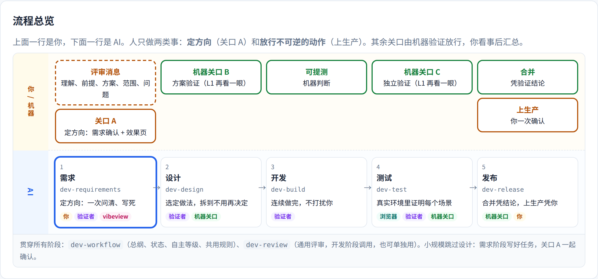
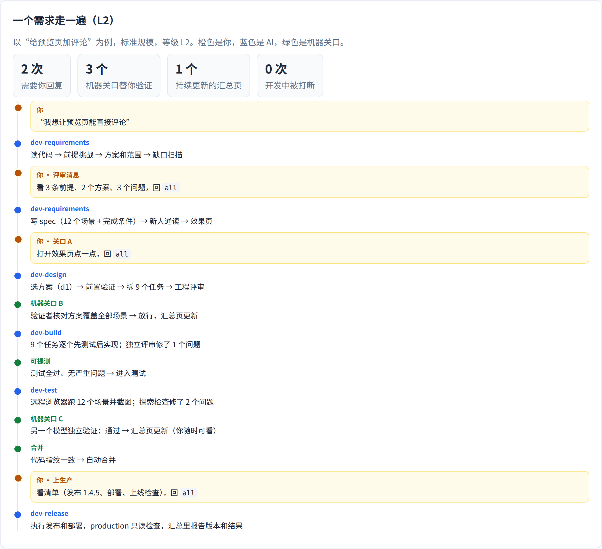

# devflow：AI 辅助开发流程（dev-* skills）

一套给 Claude Code 和 Codex 用的开发流程 skills。**人只做两类事：定方向、放行不可逆的动作。** 方案、验收、合并由机器验证放行，人看事后汇总。



## 5 个阶段

```mermaid
flowchart LR
    R["1 需求<br/>dev-requirements"] --> A{{"关口 A<br/>你：需求确认"}}
    A --> D["2 设计<br/>dev-design"] --> B{{"机器关口 B<br/>方案验证"}}
    B --> BU["3 开发<br/>dev-build"] --> T0{{"可提测<br/>机器判断"}}
    T0 --> T["4 测试<br/>dev-test"] --> C{{"机器关口 C<br/>独立验证"}}
    C -- "不通过：返工" --> BU
    C --> RE["5 发布<br/>dev-release"] --> M{{"合并<br/>凭验证结论"}}
    M --> P{{"上生产<br/>你：一次确认"}} --> DONE(["已发布"])

    classDef human fill:#fffbeb,stroke:#b45309,color:#92400e
    classDef machine fill:#f0fdf4,stroke:#15803d,color:#166534
    classDef stage fill:#eff6ff,stroke:#2563eb,color:#1e293b
    class A,P human
    class B,T0,C,M machine
    class R,D,BU,T,RE stage
```



橙色是你，绿色是机器关口（没写过代码的验证者在真实环境里验证，通过才放行），蓝色是 AI 执行的阶段。

| 阶段 | skill | 结束于 |
|------|-------|--------|
| 1 需求 | `dev-requirements` | **关口 A**（人）：需求确认，附 vibeview 效果页 |
| 2 设计 | `dev-design` | **机器关口 B**：方案验证 |
| 3 开发 | `dev-build`（调用 `dev-review`） | **可提测**：任务完成、测试全过、评审无严重问题 |
| 4 测试 | `dev-test` | **机器关口 C**：没写过代码的验证者在真实浏览器里独立验证 |
| 5 发布 | `dev-release` | **合并**（凭验证结论）→ **上生产**（人，一次确认） |

贯穿所有阶段：`dev-workflow`（总纲：状态、续做、自主等级、共用规则）、`dev-review`（通用评审，也可单独用）。

## 机器验证

放行只认验证结论，不认 CI 全绿：验证者没写过这段代码（优先同级别的其他模型，没有就用同一模型的全新子 agent）；在真实环境里跑；每个问题要有运行证据；结论绑定提交，代码再改就复验；放松检查一律交给人。每个项目会生成一个 `verify-<项目名>` skill，写清怎样像用户一样操作这个应用。

## 自主等级

| 等级 | 你参与的点 |
|------|------------|
| L1 跟着看（新项目默认） | 关口 A；机器关口通过后看一眼；合并、上生产前确认 |
| L2 常规 | 关口 A；机器关口自动放行，你看汇总；上生产前确认 |
| L3 批量 | 一批需求一次确认；自动跑到合并；上生产前确认 |

难以回头的决定、改你定下的需求、放松检查：只暂停那一项，其余照常推进。上生产、删数据、强推、对外发消息永远要你确认。

## 让 AI 等你，而不是你等 AI

- **离开模式**：说“我要走了”“做完叫我”，AI 在独立的 worktree（`.devflow-tmp/worktrees/<短名>`，不进 git、不切换你主目录的分支）里一直做到必须由你处理的点，再通知你（Claude Code 推送通知，或你配置的飞书、企业微信、Slack、ntfy webhook）。
- **别一轮轮试错**：看了才知道喜不喜欢的事（布局、风格、文案），一次出 2–4 个方案放进同一个对比页，你回 `M2` 一次选定；原因不明显的问题，先做验证脚本，再按“假设 → 实验 → 数据”决定。
- **护栏**：`.devflow.yml` 里列出只有你能定的事（`human_decisions`）、默认关闭的对外开关（`safety_valves`）和带检查命令的不变规则（`invariants`）；改 AGENTS.md、CLAUDE.md、skill 这类约束 AI 的文件要你同意；本机配置的 `budget` 限制验证轮次、外部模型调用和云浏览器时长，超出就停下等你。
- **数据**：每个需求记 `metrics.md`（耗时、问你几次、等你多久、机器关口几轮、拦下几个问题、合并后又发现几个问题）。说“统计一下 devflow 的效果”生成统计页，用数据决定哪些规则值得留。

## 一个需求走一遍

以“给预览页加评论”为例（标准规模、L2）：你只回复 2 次，3 个机器关口替你验证，开发过程中不被打断。



借鉴来源：gstack（需求评审、决定分类、汇总简报、真实浏览器 QA）、pstack（机器验证代替确认、项目验证 skill、问题要有运行证据、能跑出答案的不问人、汇总写法）、superpowers（先查后问、新人通读、执行中裁决不停等）、Spec Kit（缺口清单、带推荐的提问）、OpenSpec（需求加场景、验收核对、项目配置）。

## 安装

```bash
git clone git@github.com:lflish/devflow.git ~/devflow
cd ~/devflow
./install.sh            # macOS / Linux：软链接到 ~/.claude/skills 和 ~/.codex/skills
./install.sh --status   # 查看安装情况
./install.sh --uninstall
```

Windows（PowerShell，用目录联接，不需要管理员权限；这个脚本还没在 Windows 上实测过）：

```powershell
git clone git@github.com:lflish/devflow.git $HOME\devflow
cd $HOME\devflow
powershell -ExecutionPolicy Bypass -File .\install.ps1          # status / uninstall 同理
```

- 链接安装：`git pull` 之后立即生效（已打开的会话要重开才会重新读取 skill 列表）。
- 目标位置已有同名的旧 dev-* 目录时，会先移到 `~/.cache/devflow-backup/<时间>/`，不会直接删除。

## 在本机快速试跑

浏览器就在本机时，最简单：不设 `DEVFLOW_BROWSER_CDP`，测试会直接用本机的 Chrome（Playwright 会提示时运行 `npx playwright install chromium`），`browser.host` 也不用配。

1. 装好 skills（上面）。
2. 进一个你想试的项目（git 仓库），对 Claude Code 或 Codex 说：“用 devflow 做 <一个小需求>”。
3. 第一次会生成 `.devflow.yml` 草稿，在关口 A 请你确认；新项目默认 L1，每个机器关口后都会请你看一眼。
4. 想看页面：装好 vibeview 的 `dview` 并设置 `DVIEW_URL`、`DVIEW_TOKEN`；没有也能跑，页面只留在本地 `docs/changes/<需求>/pages/`。

## 每台机器配置一次

1. 本机配置：`mkdir -p ~/.config/devflow && cp templates/machine-config.yml ~/.config/devflow/config.yml`，填上 `browser.host`（浏览器那台机器访问这台机器用的局域网或 Tailscale 地址）。每个项目里你自己的环境地址也写在这里（`projects` 下，键是仓库根目录），不写进项目文件；缺的地址 AI 会在用到时问你一次（不限第一次），记下后不再问。验证模型候选写在 `verify.models`。
2. 浏览器：在 shell 配置里设置 `export DEVFLOW_BROWSER_CDP=http://<浏览器主机>:9222`。
   - 远程 Chrome 用 `--remote-debugging-port=9222 --user-data-dir=<单独目录>` 启动（新版 Chrome 不允许对默认配置目录开调试端口）。Chrome 默认只监听浏览器那台的 127.0.0.1，要从这台访问，用 SSH 隧道（在这台执行 `ssh -N -L 9222:localhost:9222 <浏览器主机>`，此时地址是 `http://localhost:9222`）或在那台做端口转发。也可以用 neko、steel-browser 等直接提供 CDP 的服务。
   - 这个端口能完全控制浏览器，只在内网或 Tailscale 上开放。
   - 也可以用云浏览器（只能测公网地址，比如部署好的 staging）：在 [Steel](https://app.steel.dev) 或 [Kernel](https://dashboard.onkernel.com) 注册，把 API key 放进环境变量（例如在 `~/.bashrc` 里 `export CHROME_KEY=...`，文件权限 600），本机配置写 `browser.provider: steel`、`browser.key_env: CHROME_KEY`。Steel 已实测；免费档单个会话最长 15 分钟。
3. 可选，让 AI 能像人一样点页面（探索式检查）：
   ```bash
   claude mcp add -s user playwright -- npx @playwright/mcp@latest --cdp-endpoint "$DEVFLOW_BROWSER_CDP"
   codex mcp add playwright -- npx @playwright/mcp@latest --cdp-endpoint "$DEVFLOW_BROWSER_CDP"
   ```
   添加时地址会被固定下来，浏览器地址变了要重新添加。
4. vibeview：装好 `dview`，设置 `DVIEW_URL` 和 `DVIEW_TOKEN`。没有也能用，页面会只留在本地。

## 每个项目

不用预先做什么。第一次在项目里提需求时，AI 会读项目生成 `.devflow.yml` 草稿（命令、有哪些环境和数据规则、自主等级），在关口 A 请你确认。模板见 `templates/devflow.yml`。项目文件里地址只写变量名，不写 IP、主机名、密钥。

需求文件放在 `docs/changes/<日期>-<短名>/`：`spec.md`、`design.md`、`tasks.md`、`decisions.md`、`metrics.md`、`review.md`、`test-report.md`、`verdict.md`、`evidence/`、`pages/`。spec 标题下的状态行记录“状态 / 阶段 / 待关口 / 等级”，换了会话也能从断点接着做。

## 用法

- 提需求：“我想给 xxx 加一个 …”（触发 dev-requirements）
- 接着做：“继续”（dev-workflow 按状态行判断从哪里接着做）
- 关口和汇总回复：`all` 全部按默认；`d2 B`、`c1 同意`、`Q3 B`、`H2 改为 …`、`E1 加入`、`按 L2 跑`、`问 d3`、`重做 <原因>`
- 单独用某个阶段：“评审一下这段代码”“跑一下测试”——找不到需求文件夹时只做这一步，不会自动往下走

## 许可证

[MIT](LICENSE)
