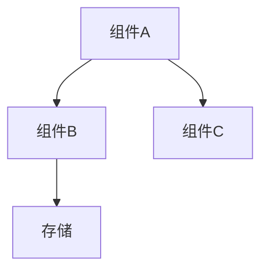

# dev-design —— 技术设计

## 工作流程

### 第一步：对齐需求

开始设计前，**必须先读取 `docs/requirements.md`**。如果文件不存在或其中有未决的"待拍板问题"，停下来告知用户：

> 需求文档尚未就绪（缺失 / 有未决问题），请先完成需求阶段（/dev-requirements）。

确认需求文档完整后，简要复述核心需求（3 条以内），与用户对齐再继续。

### 第二步：撰写设计文档

按下面的模板生成 `docs/design.md`。如果 `docs/` 目录不存在则先创建。

### 第三步：前置验证

设计文档中列出的"前置验证项"，逐项执行验证（运行命令、检查依赖、测试连通性等），在文档中标记通过/失败。有失败项时，需要调整设计方案或与用户讨论，直到全部通过。

### 第四步：确认

设计文档完成且前置验证全部通过后，请用户确认关键决策：

> 关键设计决策确认：
> 1. 架构方案：…
> 2. 技术选型：…
> 3. …
>
> 以上是否同意？有需要调整的吗？

用户确认后，本阶段完成。

## 设计文档模板

```markdown
# 技术设计：<项目/功能名称>

> 状态：草稿 | 已确认
> 最后更新：<日期>
> 对应需求：docs/requirements.md

## 1. 总体架构

用文字描述系统/功能的整体结构，说明核心组件及其关系。

如果涉及多个组件或服务，用 mermaid 图辅助说明：



说明每个组件的职责、输入输出、以及组件间的通信方式。

## 2. 技术选型

| 选型项 | 选定方案 | 理由 | 被否备选 | 否决原因 |
|--------|---------|------|---------|---------|
| 语言/框架 | … | … | … | … |
| 数据库 | … | … | … | … |
| … | … | … | … | … |

只列需要做选择的项，不罗列无争议的默认项（如"用 git 做版本管理"不需要列）。

## 3. 接口定义

列出系统对外暴露的接口或模块间的关键接口。

### 3.1 <接口名称>

- **路径/方法签名**：…
- **请求参数**：

| 参数 | 类型 | 必填 | 说明 |
|------|------|------|------|
| … | … | … | … |

- **返回结果**：

```json
{
  "示例": "…"
}
```

- **错误码**：

| 错误码 | 含义 | 处理建议 |
|--------|------|---------|
| … | … | … |

如果不是 HTTP 接口（如 CLI、库 API、消息队列），调整格式匹配实际形态。没有对外接口的纯内部模块可省略此节。

## 4. 数据模型

列出核心数据结构、数据库表或配置文件格式。

```sql
-- 示例：数据库表
CREATE TABLE example (
    id SERIAL PRIMARY KEY,
    name VARCHAR(255) NOT NULL,
    created_at TIMESTAMP DEFAULT NOW()
);
```

或用结构体/类型定义：

```
type Example struct {
    ID   int
    Name string
}
```

说明字段含义、约束、索引策略。没有持久化数据的项目可省略此节。

## 5. 错误处理与安全考虑

### 错误处理策略

- 描述错误分类（可恢复 vs 不可恢复）
- 错误传播方式（返回错误码 / 抛异常 / 日志告警）
- 关键路径的降级策略（如有）

### 安全考虑

- 认证与授权方式
- 敏感数据处理（加密、脱敏）
- 输入校验策略

没有安全相关场景的内部工具可精简此节，但要明确说明"本项目不涉及外部用户输入/敏感数据"。

## 6. 部署形态

说明最终交付物的运行方式：

- **运行环境**：本地 CLI / Docker 容器 / 云服务 / …
- **依赖服务**：数据库、消息队列、第三方 API 等
- **配置管理**：环境变量 / 配置文件 / …
- **监控与日志**：…（如有）

## 7. 前置验证项

> ⚠️ 以下假设必须在开工前实测验证通过，否则设计方案需要调整。

| # | 假设 | 验证方法 | 通过标准 | 状态 |
|---|------|---------|---------|------|
| V1 | … | … | … | ⬜ 待验证 / ✅ 通过 / ❌ 失败 |
| V2 | … | … | … | ⬜ 待验证 |

每项写清：
- **假设**：我们认为成立的前提条件
- **验证方法**：具体执行什么命令或操作来验证
- **通过标准**：什么结果算通过

没有需要验证的前提假设时，注明"无前置验证项"。

## 8. 关键决策记录

| # | 决策 | 理由 | 代价/权衡 |
|---|------|------|----------|
| D1 | … | … | … |
| D2 | … | … | … |

记录设计过程中做出的重要取舍，方便后续回溯"为什么当时这样选"。
```

## 注意事项

- **需求先行**：没有已确认的需求文档，不开始设计。这是硬性前置条件。
- **前置验证必做**：不要假设依赖可用、网络可达、API 兼容——写下来、验一遍。验证失败的项必须解决后才能进入下一阶段。
- **选型要有备选**：每个技术选型至少考虑一个备选方案并说明否决理由，避免"只因为熟悉就选了"的情况。
- **接口先于实现**：接口定义要具体到参数和返回值，不能只写"提供查询接口"。
- **决策留痕**：关键决策必须记录理由和代价，不要只记结论。
- **产物落地**：最终必须写出 `docs/design.md` 文件，口头讨论不算完成。
