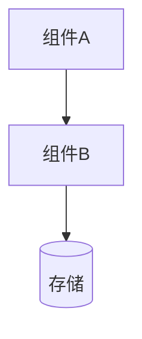

# design.md 模板

只写需要做选择、或别人看代码猜不出来的东西。没有内容的小节直接删掉，不要写“无”占位。

````markdown
# 技术设计：<需求名>

对应需求：spec.md（R1–R6）　更新：YYYY-MM-DD

## 1. 方案

考虑过的做法（2–3 个），各自的取舍，选了哪个、为什么：

| 方案 | 做法 | 好处 | 代价 | 结论 |
|------|------|------|------|------|
| A | … | … | … | 选用（原则 2：复用现有的 …） |
| B | … | … | … | 放弃：… |

只有一种合理做法时，写一句为什么其他做法不适用。

## 2. 总体结构

核心组件、各自职责、彼此怎么通信。涉及多个组件时配一张图：



## 3. 技术选型

只列需要做选择的项：

| 选型项 | 选定 | 理由 | 放弃的备选 | 放弃原因 |
|--------|------|------|------------|----------|

## 4. 接口

对外接口和模块间的关键接口，写到参数和返回值：

### 4.1 <接口名>

- 路径 / 签名：…
- 参数：

| 参数 | 类型 | 必填 | 说明 |
|------|------|------|------|

- 返回：

```json
{ "示例": "…" }
```

- 错误：

| 错误 | 什么时候 | 调用方怎么处理 |
|------|----------|----------------|

不是 HTTP 接口时（命令行、库函数、消息），按实际形式写。

## 5. 数据

表结构、数据结构或配置格式；字段含义、约束、索引；已有数据要不要迁移、怎么迁移。

## 6. 状态和流程

有状态变化的，画出状态和触发条件；有多步流程的，写清每一步失败时怎么办。

## 7. 错误处理和安全

- 错误分类（可恢复 / 不可恢复）、怎么传递、要不要降级
- 认证和授权：谁能调用、怎么校验
- 敏感数据：存储、日志里怎么处理
- 输入校验

## 8. 对需求的覆盖

| 需求 | 由哪部分实现 |
|------|--------------|
| R1 | 4.1 接口 + 5 数据表 comments |

## 9. 前置验证

开工前必须实测成立的假设：

| # | 假设 | 验证方法（命令或操作） | 通过标准 | 结果 |
|---|------|------------------------|----------|------|
| V1 | … | … | … | ✅ 通过 / ❌ 失败：… |

## 10. 变更

实现中对设计的调整，每条一行：

- YYYY-MM-DD 原为 …，实现时发现 …，改为 …（见 decisions.md #7）

## 11. 方案验证（机器关口 B）

- 结论：通过 / 通过，有备注 / 不通过
- 验证者：<模型>（为什么是它，例如“codex 探测超时，退回 same”）
- 对照：需求和场景 → 设计和任务（列表）
- 重跑的前置验证：命令和结果
- 未决定、只能由用户决定的事：c1 …（没有写“无”）
````

关键决定不再单独写在设计文档里，统一记在 `decisions.md`；设计里引用编号即可。
